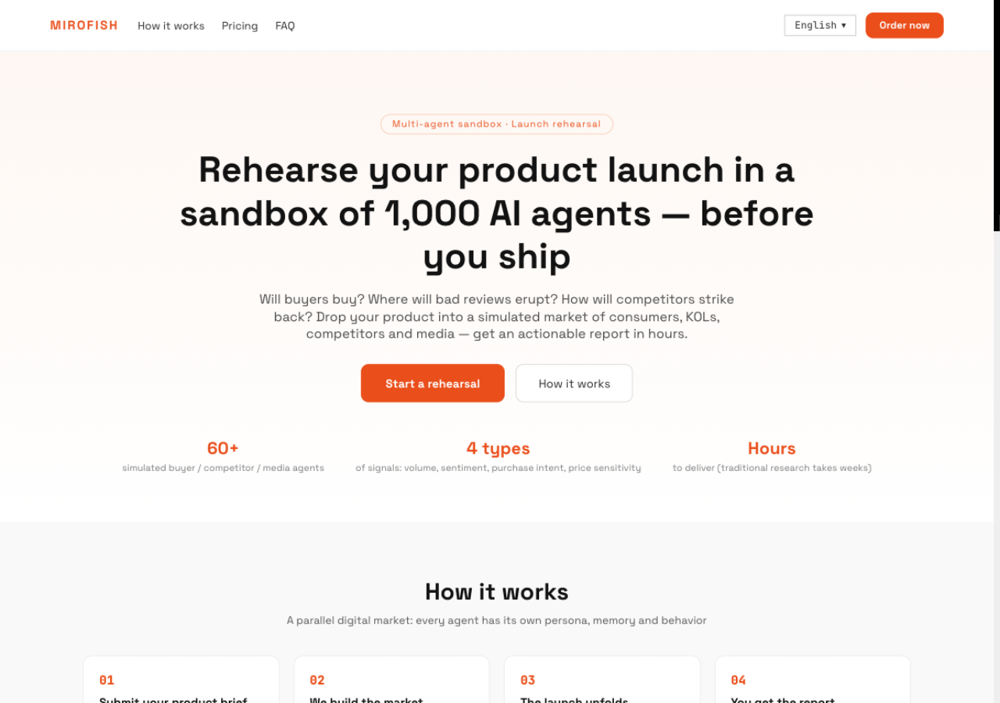
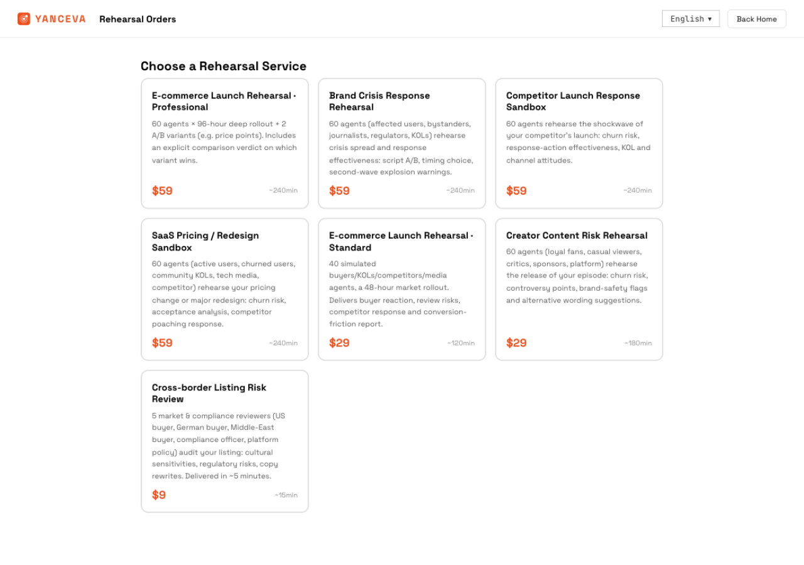
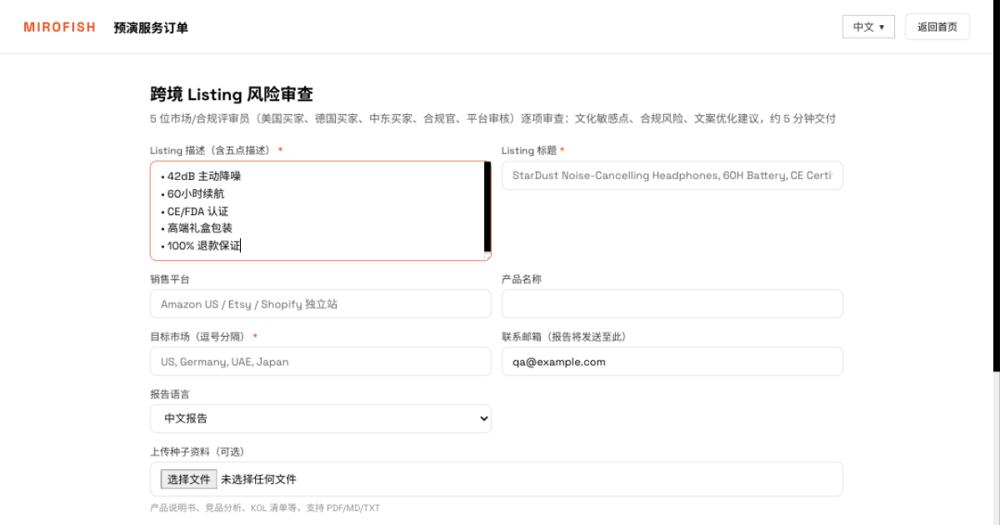
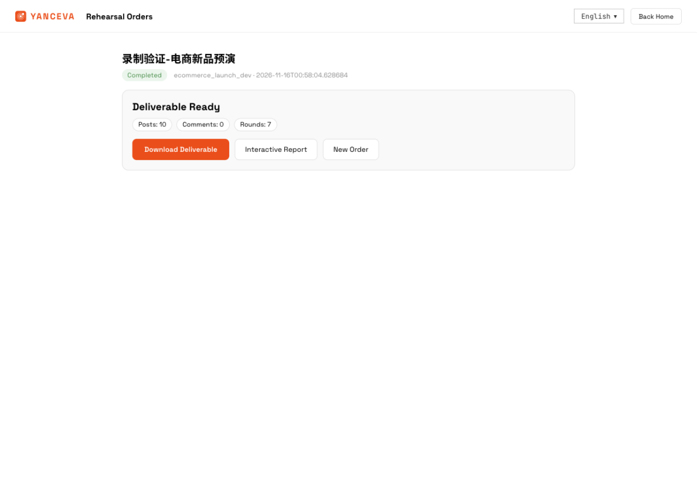
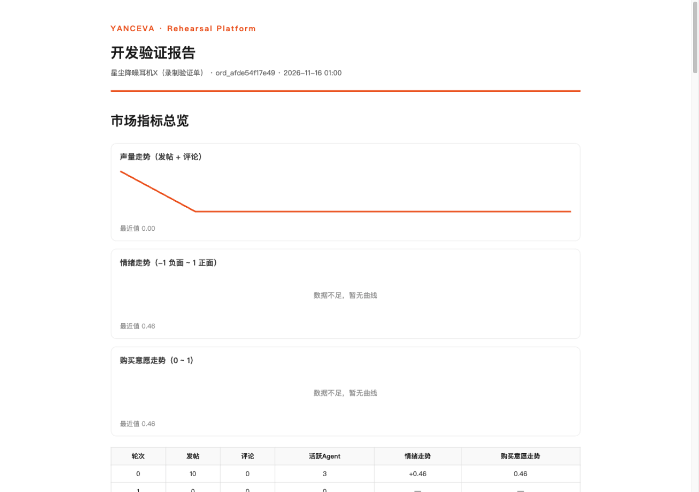
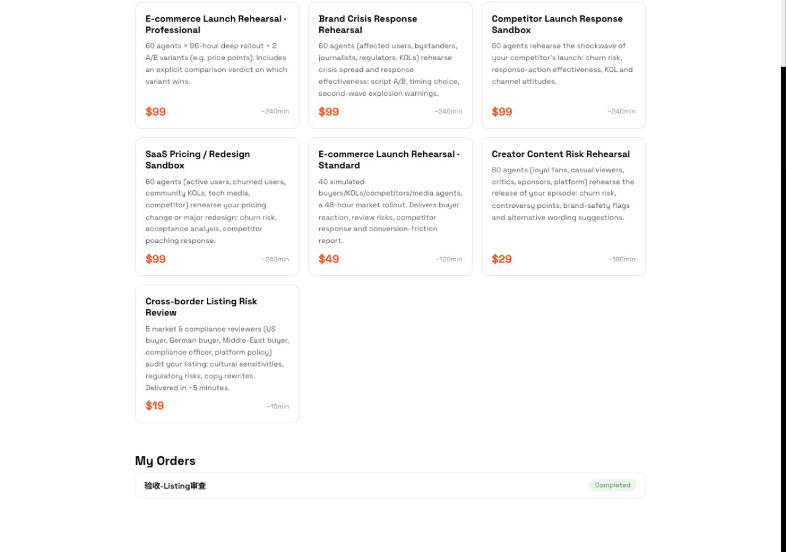
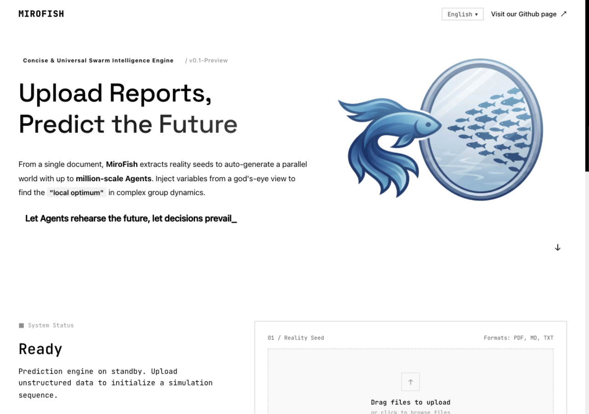

# Yanceva 预演平台（电商新品上市预演改造版）

> 基于 [MiroFish](https://github.com/666ghj/MiroFish) 多智能体预测引擎改造的**商业化预测平台**：
> 6 个垂直预演服务在线接单，AI Agent 沙盘推演，小时级交付决策报告。

> **License**: This project is a modified version of [MiroFish](https://github.com/666ghj/MiroFish), licensed under **AGPL-3.0**.
> Per AGPL-3.0 §13, the complete modified source code is publicly available in this repository.
> See [SOURCE-NOTICE.md](SOURCE-NOTICE.md) for the full modification list and compliance notes.


详细操作手册见 [`docs/ecommerce-rehearsal.md`](docs/ecommerce-rehearsal.md)，本文是平台全景。

---

## 平台一览

| # | 服务 | 类型 | 定价 | 交付物 | 状态 |
|---|---|---|---|---|---|
| 1 | 电商新品上市预演（标准/专业） | 沙盘模拟 | $29/$59 | 买家反应、差评风险、竞品反应、转化阻力报告 | ✅ 在售 |
| 2 | SaaS 定价/改版沙盘 | 沙盘模拟 | $59 | 用户流失风险、竞品截流反应、定价接受度报告 | ✅ 在售 |
| 3 | 品牌危机回应预演 | 沙盘模拟 | $59 | 危机传播路径、回应话术 A/B、二次引爆点预警 | ✅ 在售 |
| 4 | 跨境 Listing 风险审查 | 评审单 | $9 | 文化敏感点、合规风险、文案优化建议（~5 分钟） | ✅ 在售 |
| 5 | 竞品发布应对沙盘 | 沙盘模拟 | $59 | 竞品动作预判、应对策略、渠道反应报告 | ✅ 在售 |
| 6 | 创作者内容风险预演 | 沙盘模拟 | $29 | 掉粉风险、品牌方敏感点、替代表达建议 | ✅ 在售 |

所有服务：**无需海外公司即可收款**（Creem MoR 代收代缴）、**中英双语界面与报告**、**无 GPU 依赖**（LLM 走 DeepSeek API，Embedding 本地 Ollama）。

## 全流程演示

### 第 1 步：营销落地页

访客从落地页了解服务价值，点击「Start a rehearsal」进入订单门户。



### 第 2 步：选择服务（6 大场景 7 个 SKU）

订单门户展示全部服务卡片，每张卡标注价格与交付时限。



### 第 3 步：填写提交表单

表单按 SKU 动态渲染（JSON Schema 驱动），支持中英文表单、上传种子资料（产品文档/竞品分析/KOL 清单）、选择报告语言：



### 第 4 步：支付 → 排队 → Worker 自动执行

支付后订单进入队列（Stripe/Creem webhook 自动入队），Worker 认领后自动完成
本体生成 → 知识图谱(Graphiti+Neo4j) → Agent 人设 → 双平台模拟 → 市场指标 → 报告：

- 进度页实时显示各阶段（本体验收过完整闭环：SUCCEEDED/100%）
- 市场指标（声量/情绪/购买意愿）落成时间序列，交付物含 SVG 图表

### 第 5 步：拿到交付报告

完成后订单页显示 Completed 状态与指标摘要（发帖数/轮次），一键下载品牌化 HTML 交付报告：



交付报告包含指标图表 + Agent 原文引用 + 行动建议 + 方法论说明 + 免责声明：



也可进入在线交互报告页继续追问（ReACT Agent 支持采访模拟角色）。



### 附：推演工作台（沙盘单的完整推演过程）



## 一键部署

```bash
bash scripts/deploy.sh setup    # 首次：环境检查 + .env 生成 + 容器 + 依赖 + 构建 + 测试 + 冒烟
bash scripts/deploy.sh start    # 启动 API(gunicorn) + Worker
bash scripts/deploy.sh status   # 状态：容器/服务/订单队列
bash scripts/deploy.sh verify   # 图谱全链路复检
bash scripts/deploy.sh stop     # 停止
```

启动后访问 `http://<服务器>:5001/`（前端构建产物由后端单进程托管）。

## 支付渠道（个人可接）

| 平台 | 费率 | 说明 |
|---|---|---|
| **Creem**（已接入 ✅） | ~4% + $0.40 | MoR 模式：个人可开、无需海外公司、代处理全球税务、**支付宝直提人民币** |
| Stripe（已接入 ✅，备用） | 2.9% + $0.30 | 需海外实体 |
| dev 模式（本地开发） | — | 免费直接入队；生产环境自动禁用（`ALLOW_DEV_PAYMENT`） |

配置方式见 `.env.example`；每个 SKU 在 `backend/uploads/products/catalog.json` 填入 Creem 的 `creem_product_id`。

## 多语言

- 站点界面：中/英（`locales/*.json`，默认英文），新增语言 = 添加一个 JSON 文件
- 商品目录：SKU 名称/表单/交付物名称按 `Accept-Language` 返回（catalog 中 `i18n` 字段）
- 报告语言：客户下单时选择，推演与报告全文跟随
- 预留：es/fr/pt/ru/de 已在语言注册表中声明，随时可加

## 合规与信任

- Cookie 同意弹窗（GDPR 风格，接受/仅必要）
- 隐私政策与服务条款页面（`/privacy`、`/terms`，模板性质，建议法务复核）
- 订单数据隔离（按邮箱查询）、交付物归属校验、支付状态守卫

## 架构

```
前端 (Vue3 + Vite 构建 → 由后端单进程托管)
   │
   ▼
Flask API (:5001, gunicorn)
   ├─ scenarios/          场景注册表：7 个场景包（舆情 + 6 个商业场景）
   ├─ graph_store/        Graphiti + Neo4j 图谱（bolt :7687）
   ├─ review_executor/    评审单执行器（Listing 审查，无模拟）
   ├─ market_metrics/     市场信号层（规则指标 + LLM 分类 + 问卷探针）
   ├─ order/ + campaign/  订单系统 + A/B 对比预演
   ├─ worker.py           订单 Worker（可横向多机部署，认领→执行→交付）
   └─ payment.py          支付抽象（Creem / Stripe / dev）
        │
        ├─ LLM: DeepSeek（CompatOpenAIGenericClient 端点兼容层）
        ├─ Embedding: Ollama Qwen3-Embedding（本地）
        └─ Neo4j Community（单容器）
```

## 当前验证状态（2026-11-15）

| 验证项 | 状态 |
|---|---|
| 自动化测试 | ✅ 144 passed（含 7 场景注册/订单生命周期/支付/安全加固用例） |
| 电商沙盘端到端 | ✅ SUCCEEDED（真实订单，提交→交付全链路） |
| Listing 审查端到端 | ✅ SUCCEEDED（5 评审员、39 风险点、综合评分） |
| 图谱冒烟（真 Neo4j + 真 LLM + 真 Embedding） | ✅ 全部校验通过 |
| 前端构建 + 全页面路由 | ✅ 200 |
| 生产部署形态 | ✅ gunicorn + SPA 托管 + Worker 守护进程 |

## 上线检查清单

1. 服务器（海外 VPS 2C4G 起，无需 GPU）+ 域名 + Cloudflare SSL
2. `.env`：`PAYMENT_MODE=creem`、Creem 密钥、删除 `ALLOW_DEV_PAYMENT`、锁定 `CORS_ORIGINS`
3. Creem 后台：为每个 SKU 创建 Product → `prod_xxx` 填入 catalog.json；webhook 指向 `/api/orders/creem/webhook`
4. `index.html` 中 3 处 `yanceva.com` 替换为真实域名（canonical/og:url/hreflang）
5. `bash scripts/deploy.sh setup && start` → 用真实卡走一笔小额订单全链路验证
6. 定时备份 `orders.db` 与 `uploads/`（客户资料属商业敏感数据）

## 已知限制

1. graphiti-core 钉在 0.11.6（camel-oasis 依赖 neo4j==5.23.0 的版本冲突）
2. Worker 与 API 需同机/共享文件系统（SQLite + 本地 uploads；跨机 = Phase 2 MinIO+Postgres）
3. 模拟中 runner 状态保持 running（环境保留给 Interview），Worker 通过 close_env 收尾——已在 worker 内自动化
4. 换 Embedding 模型需重建已建图谱

## 成本结构（每单边际成本）

| 项目 | 成本 |
|---|---|
| DeepSeek LLM | ¥3-10/沙盘单、¥0.5-2/评审单 |
| Embedding | $0（本地 Ollama） |
| 基础设施 | ~$10/月（VPS + 域名摊销） |
| 支付渠道费 | ~4.4% |
| **毛利率** | **>90%** |

## 致谢

- [MiroFish](https://github.com/666ghj/MiroFish) — 上游引擎（简洁通用的群体智能引擎）
- [graphiti](https://github.com/getzep/graphiti) — 实时时序知识图谱
- [camel-ai / OASIS](https://github.com/camel-ai/camel) — 社交媒体模拟框架
- [Neo4j Community](https://neo4j.com/) / [Ollama](https://ollama.com/) / [Qwen3-Embedding](https://qwenlm.github.io/) / [DeepSeek](https://platform.deepseek.com/) / [Creem](https://creem.io/)
