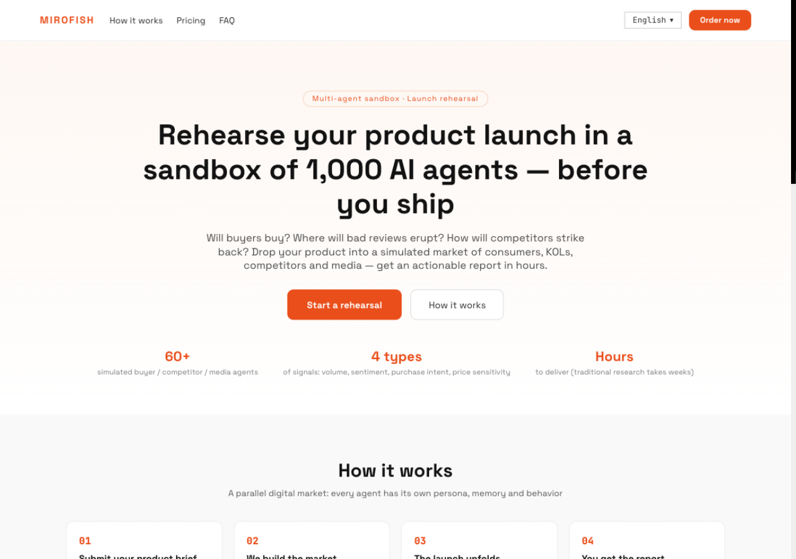
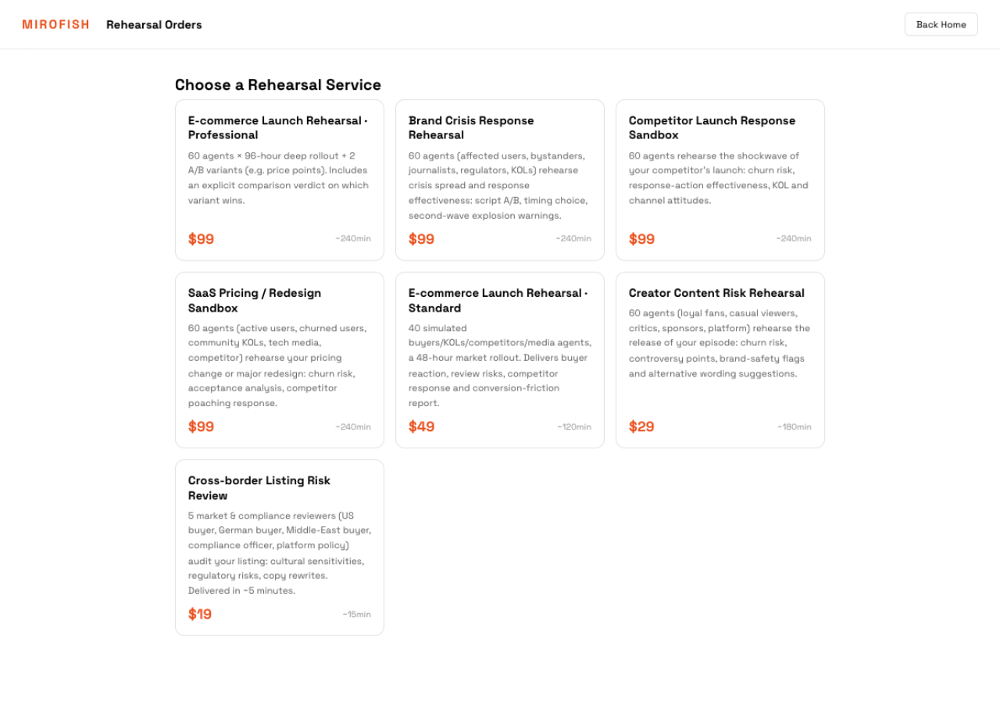
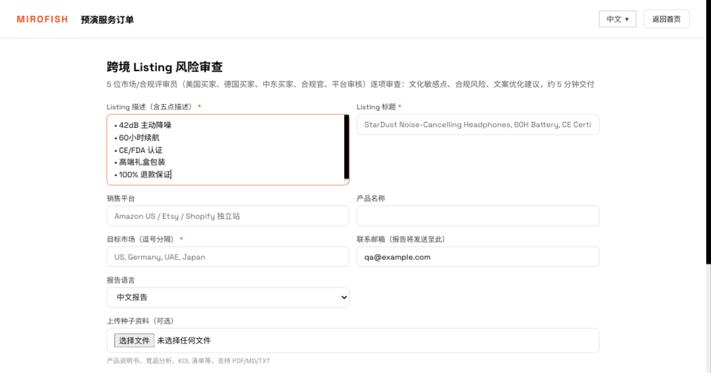

<div align="center">

# Yanceva 预演平台

**AI 业务预演平台 — 在承诺之前模拟结果**

[English](./README.md) | [中文](./README-ZH.md) | [许可证：AGPL-3.0](./LICENSE) | [修改声明](./SOURCE-NOTICE.md)


</div>

---

## Yanceva 是什么？

Yanceva 是一个商业化的 **AI 预演平台**：在新品上市、调整 SaaS 定价、回应品牌危机或发布内容之前——把你的业务场景扔进一个由 AI 角色（买家、批评者、竞品、记者）组成的沙盘中，实时观察市场反应。

你将收到一份决策报告，包含**量化指标**（声量、情绪、购买意愿）、**角色原话引用**、**风险评估**和**行动建议**——数小时交付，而非数周。

## 六大场景

| # | 服务 | 类型 | 定价 | 交付物 |
|---|---|---|---|---|
| 1 | 电商新品上市预演（标准/专业） | 沙盘模拟 | $29/$59 | 买家反应、差评风险、竞品反应、转化阻力 |
| 2 | SaaS 定价/改版沙盘 | 沙盘模拟 | $59 | 流失风险、竞品截流反应、定价接受度 |
| 3 | 品牌危机回应预演 | 沙盘模拟 | $59 | 危机传播路径、回应话术 A/B、二次引爆预警 |
| 4 | 跨境 Listing 风险审查 | 评审团 | $9 | 文化敏感点、合规风险、文案改写（约 5 分钟） |
| 5 | 竞品发布应对沙盘 | 沙盘模拟 | $59 | 竞品动作预判、应对策略、渠道反应 |
| 6 | 创作者内容风险预演 | 沙盘模拟 | $29 | 掉粉风险、争议点、品牌安全、替代表达 |

## 工作流程

```
1. 提交业务资料            → 表单 + 可选资料（PDF/MD/TXT）
2. 60 个 AI Agent 模拟市场 → 独立人设、记忆、事件时间线
3. 收到决策报告            → 量化指标 + 角色原话 + 行动建议
```

技术栈：**DeepSeek LLM** + **Graphiti/Neo4j 知识图谱** + **OASIS 双平台模拟** + **Ollama 本地 Embedding**。无需 GPU。

## 界面截图





## 快速开始

```bash
# 1. 配置
cp .env.example .env   # 编辑：LLM_API_KEY、NEO4J_PASSWORD、支付密钥

# 2. 启动基础设施（Neo4j + Ollama Embedding）
docker compose up -d neo4j ollama
docker exec mirofish-ollama ollama pull qwen3-embedding:0.6b

# 3. 一键部署（环境检查、构建、测试、冒烟验证）
bash scripts/deploy.sh setup
bash scripts/deploy.sh start

# 4. 打开 http://localhost:5001
```

### 验证

```bash
cd backend && uv sync
uv run pytest tests/ -q                                      # 147 个测试
uv run python scripts/validate_graphiti_full_loop.py         # 图谱端到端（无需 LLM key）
uv run python scripts/validate_graphiti_integration.py       # 完整生产路径（需 LLM key）
```

### Worker（订单执行）

```bash
uv run python -m app.worker --worker-id worker_1 --concurrency 1
# 增加机器或 Worker 即可横向扩容——自动从共享队列认领订单
```

## 文档

- [上线检查清单](docs/LAUNCH-CHECKLIST.md) — 域名、VPS、Creem 支付、.env、法务
- [使用手册](docs/ecommerce-rehearsal.md) — 场景详情、API 参考
- [营销文稿](docs/MARKETING-CONTENT.md) — 10 篇推广文章草稿
- [上游引擎文档](README-MiroFish-upstream.md) — 原版 MiroFish 说明

## 许可证

本项目基于 [MiroFish](https://github.com/666ghj/MiroFish) 修改，遵循 **GNU Affero General Public License v3.0**。

- 原始许可证全文：[LICENSE](./LICENSE)（版权归 MiroFish 原作者所有）
- 根据 **AGPL-3.0 第 13 条**，本网络服务的完整修改源代码通过本公开仓库提供
- 完整修改清单：[SOURCE-NOTICE.md](./SOURCE-NOTICE.md)

如果你部署了修改版本作为网络服务，你也必须根据 AGPL-3.0 向你的用户提供源代码。

## 致谢

- [MiroFish](https://github.com/666ghj/MiroFish) — 上游引擎（简洁通用的群体智能引擎）
- [graphiti](https://github.com/getzep/graphiti) — 实时时序知识图谱
- [camel-ai / OASIS](https://github.com/camel-ai/camel) — 社交媒体模拟框架
- [Neo4j Community](https://neo4j.com/) · [Ollama](https://ollama.com/) · [Qwen3-Embedding](https://qwenlm.github.io/) · [DeepSeek](https://platform.deepseek.com/) · [Creem](https://creem.io/)
