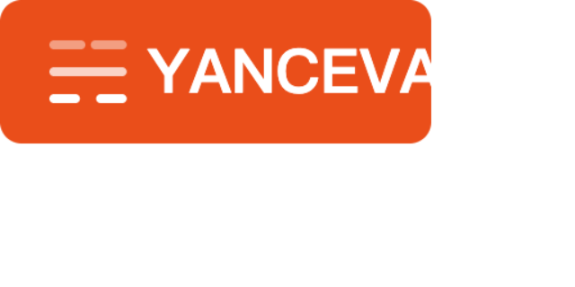
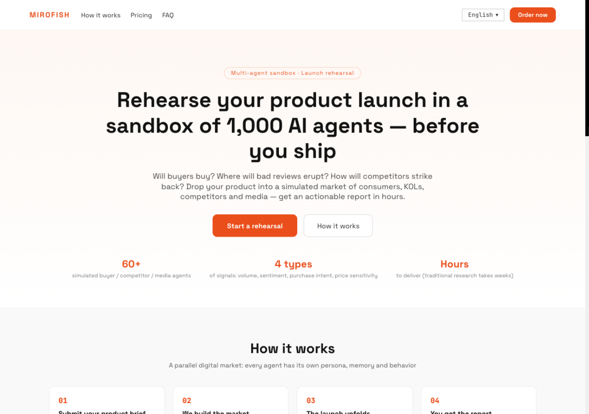
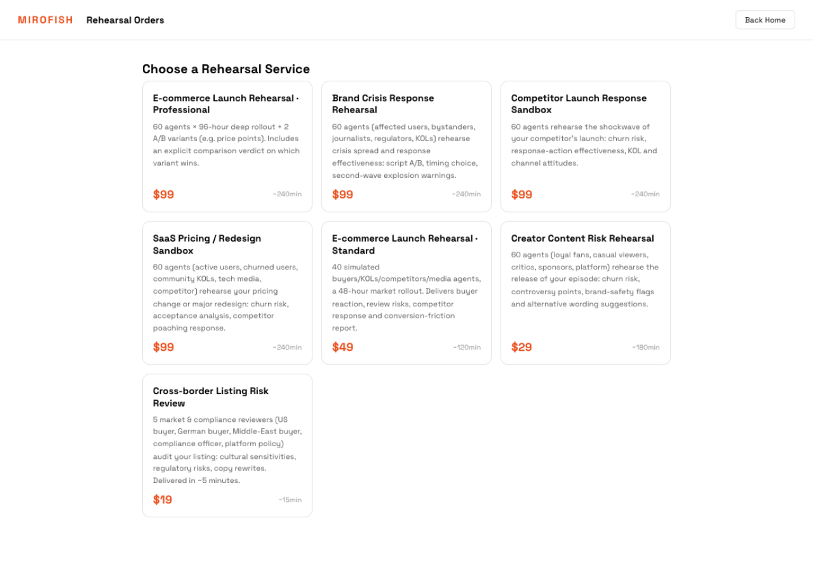
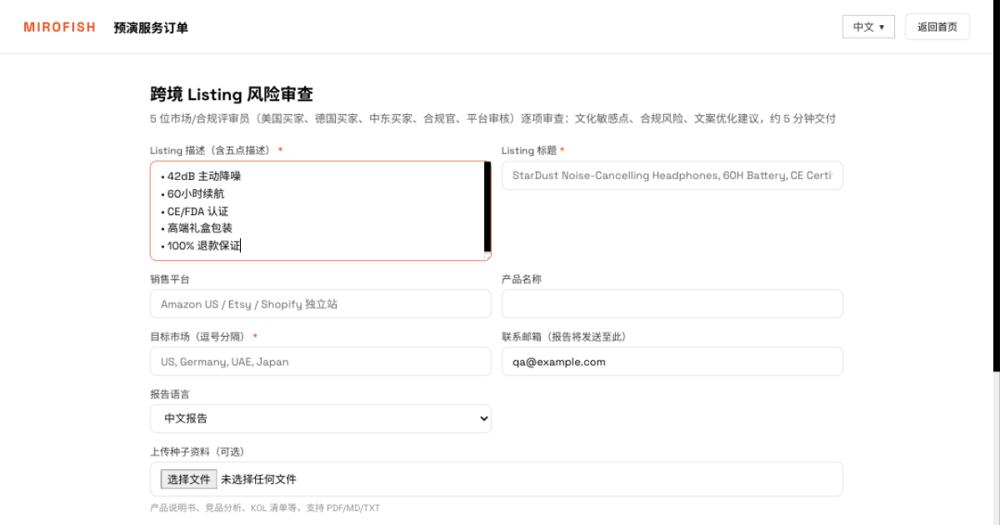

<div align="center">

# Yanceva

**AI Business Rehearsal Platform — simulate decisions before you commit**

[English](./README.md) | [中文](./README-ZH.md) | [License: AGPL-3.0](./LICENSE) | [Modification Notice](./SOURCE-NOTICE.md)



</div>

---

## What is Yanceva?

Yanceva is a commercial **AI rehearsal platform**: before you launch a product, change your SaaS pricing, respond to a crisis, or publish content — you drop your scenario into a sandbox of AI agents (buyers, critics, competitors, journalists) and watch your market react.

You get a decision report with **quantified metrics** (volume, sentiment, purchase intent), **verbatim agent quotes**, **risk assessments** and **action items** — delivered in hours, not weeks.

## Six Scenarios

| # | Service | Type | Price | Deliverable |
|---|---|---|---|---|
| 1 | E-commerce Launch Rehearsal (Standard/Pro) | Simulation | $29/$59 | Buyer reaction, review risks, competitor response, conversion friction |
| 2 | SaaS Pricing / Redesign Sandbox | Simulation | $59 | Churn risk, competitor poaching response, pricing acceptance |
| 3 | Brand Crisis Response Rehearsal | Simulation | $59 | Crisis spread path, response script A/B, second-wave warnings |
| 4 | Cross-border Listing Risk Review | Review panel | $9 | Cultural sensitivities, compliance risks, copy rewrites (~5 min) |
| 5 | Competitor Launch Response Sandbox | Simulation | $59 | Competitor action prediction, response strategy, channel reaction |
| 6 | Creator Content Risk Rehearsal | Simulation | $29 | Churn risk, controversy points, brand safety, alternative wording |

## How It Works

```
1. Submit your brief        → form + optional seed docs (PDF/MD/TXT)
2. 60 AI agents simulate    → unique personas, memory, event timelines
3. Get your decision report → quantified metrics + verbatim quotes + action items
```

Powered by: **DeepSeek LLM** + **Graphiti/Neo4j knowledge graph** + **OASIS dual-platform simulation** + **Ollama local embeddings**. No GPU required.

## Screenshots





## Quick Start

```bash
# 1. Configure
cp .env.example .env   # edit: LLM_API_KEY, NEO4J_PASSWORD, payment keys

# 2. Start infra (Neo4j + Ollama embedding)
docker compose up -d neo4j ollama
docker exec mirofish-ollama ollama pull qwen3-embedding:0.6b

# 3. Deploy (checks env, builds, tests, smoke-verifies)
bash scripts/deploy.sh setup
bash scripts/deploy.sh start

# 4. Open http://localhost:5001
```

### Verify

```bash
cd backend && uv sync
uv run pytest tests/ -q                                      # 147 tests
uv run python scripts/validate_graphiti_full_loop.py         # graph E2E (no LLM key needed)
uv run python scripts/validate_graphiti_integration.py       # full production path (needs LLM key)
```

### Worker (order execution)

```bash
uv run python -m app.worker --worker-id worker_1 --concurrency 1
# add more machines/workers for capacity — they auto-claim from the shared queue
```

## Documentation

- [Deployment checklist](docs/LAUNCH-CHECKLIST.md) — domain, VPS, Creem payment, .env, legal
- [Usage guide](docs/ecommerce-rehearsal.md) — scenario details, API reference
- [Marketing content](docs/MARKETING-CONTENT.md) — 10 promotional article drafts
- [Upstream engine README](README-MiroFish-upstream.md) — original MiroFish documentation

## License

This project is a modified version of [MiroFish](https://github.com/666ghj/MiroFish), licensed under the **GNU Affero General Public License v3.0**.

- Original license text: [LICENSE](./LICENSE) (copyright belongs to the MiroFish authors)
- Per **AGPL-3.0 §13**, the complete modified source code of this network service is publicly available in this repository
- Full list of modifications: [SOURCE-NOTICE.md](./SOURCE-NOTICE.md)

If you deploy a modified version as a network service, you must also provide your source code to your users under AGPL-3.0.

## Acknowledgements

- [MiroFish](https://github.com/666ghj/MiroFish) — upstream engine (concise & universal swarm intelligence engine)
- [graphiti](https://github.com/getzep/graphiti) — real-time temporal knowledge graphs
- [camel-ai / OASIS](https://github.com/camel-ai/camel) — social simulation framework
- [Neo4j Community](https://neo4j.com/) · [Ollama](https://ollama.com/) · [Qwen3-Embedding](https://qwenlm.github.io/) · [DeepSeek](https://platform.deepseek.com/) · [Creem](https://creem.io/)
